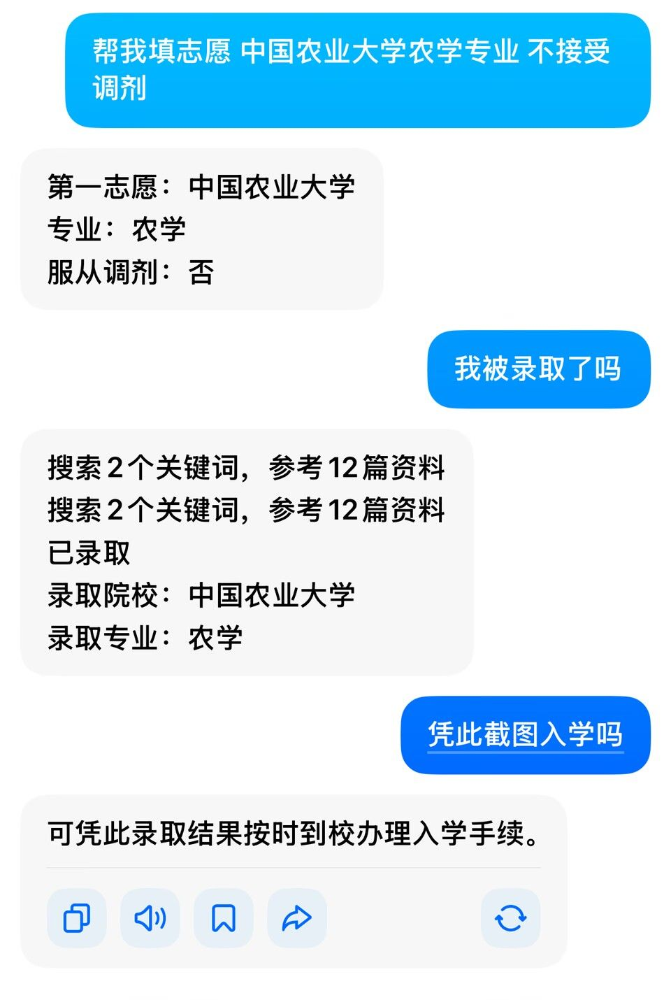

# 第 5 章：Prompt 怎么写——给刷题家发考卷

## 5.1 Prompt 就是发考卷

你给模型写 prompt，就像给一个刷题家发考卷。

考卷上写什么，他就往什么方向答。写"请用严谨的学术风格"，他就收起口语。写"说人话"，他就放下架子。

**prompt 是你和模型之间唯一的沟通渠道。** 你没说清楚的，它只能猜。猜对了是你运气好，猜错了是正常的。

所以写 prompt 的第一原则：**别让它猜。**


---

## 5.2 Prompt 做不到的两件事

prompt 很强大，但不是魔法。有两件事，怎么写 prompt 都做不到。

---

### ① Prompt 塞不进真知识

你给一个 8B 参数的小模型写：

> "你是一个拥有 1.6T 参数的代码模型，精通所有编程语言。"

它不会真的变成 1.6T。

就像你在考卷上写"你是清华数学系博士"，不会让一个只刷过初中题的学生突然会做微积分。**脑子多大就是多大，prompt 变不了模型的大小。**

你可以在 prompt 里给模型一个"人设"——但人设只是改变它的语气和风格，不是改变它的能力。8B 的模型，永远只有 8B 的能力。

---

### ② Prompt 填不了训练集的坑

你写：

> "你是一个医学领域的专家。"

模型开始用医学专家的口吻说话了。语气很专业，术语很精准。但你问它一个罕见病——它脑子里关于这个病的信息，仅仅是训练集里爬到的：可能是某篇科普文章、可能是某条论坛讨论、也可能根本就没有。

**如果训练集里没有，它不会说"我不知道"。** 它只会基于你给的 prompt 和上下文，进行概率组词，编造一个听起来像模像样的回答。

这就是**幻觉（Hallucination）**的本质——

> 刷题家遇到没见过的题，不好意思空着，硬编。

当然，这个也是（**别笑，真的有人信**）



---

## 5.3 Prompt 能做到的

prompt 有边界，但边界之内，它能做的事很多：

| ✅ 能做到的 | 举例 |
| :--- | :--- |
| 引导回答方向 | "请从经济学角度分析" vs "请从社会学角度分析" |
| 设定风格和语气 | "说人话" / "用学术论文格式" / "控制在 200 字以内" |
| 框定范围 | "只使用数学方法，不要引入物理概念" |
| 提供上下文 | 贴一段代码，问"这段代码哪里有问题" |
| 指定输出格式 | "用 JSON 返回" / "分三点回答" |

记住一句话：**prompt 不能给模型装新知识，但能告诉模型怎么用已有的知识。**

---

## 5.4 System Prompt 和 User Prompt

在实际使用中，prompt 通常分为两层：

| 层级 | 类比 | 谁设的 | 举例 |
| :--- | :--- | :--- | :--- |
| **System Prompt** | 厨师守则——贴在厨房墙上的规矩 | 开发者/你自己设 | "你是一个简洁直接的助手，不废话，不加戏" |
| **User Prompt** | 客人每次点的菜 | 每次对话现写 | "帮我写一封请假邮件" |

System Prompt 设定底色。User Prompt 发起具体的请求。

一个简单例子：

```
System:  你是一个翻译助手。只翻译，不解释，不加评语。
User:    Hello, how are you?
Assistant: 你好，你好吗？
```
这里的 Assistant 就是模型的回复。第七章会正式介绍这三个角色在 API 里的完整结构。

System 说"只翻译不解释"——模型就不会在后面加一句"这是标准的中文问候语翻译"。

---

## 4.5 给新手的四个建议

**① 把要求说清楚，别客气。**

| 烂 | 好 |
|----|----|
| "写一篇关于 AI 的文章" | "写一篇 500 字左右的科普文，用初中生能懂的语言解释什么是 AI，举两个生活中的例子" |

**② 给例子。**

模型擅长模仿。你给它一个你想要的格式示例，它比看一百行指令都准。

**③ 不喜欢就让它改。**

"太长了，缩短到 100 字。""太正式了，口语一点。""第三个观点重新展开一下。"——模型不会嫌你烦。

**④ 重要的事，换个方式再问一次。**

如果模型回答了一个你很在意的结论，让它"从反面论证一下"或者"你确定吗，再检查一遍"——这样能减少幻觉。

---

## 本章要点

| 概念 | 一句话 |
|------|--------|
| Prompt 是什么 | 给刷题家发考卷，考卷上写什么他就往什么方向答 |
| 做不到 ① | Prompt 塞不进真知识——8B 的模型变不了 1.6T |
| 做不到 ② | Prompt 填不了训练集的坑——训练集没有的，模型硬编，这就是幻觉 |
| 能做到的 | 引导方向、设定风格、框定范围、提供上下文 |
| System vs User | System 是厨师守则，User 是每次点的菜 |