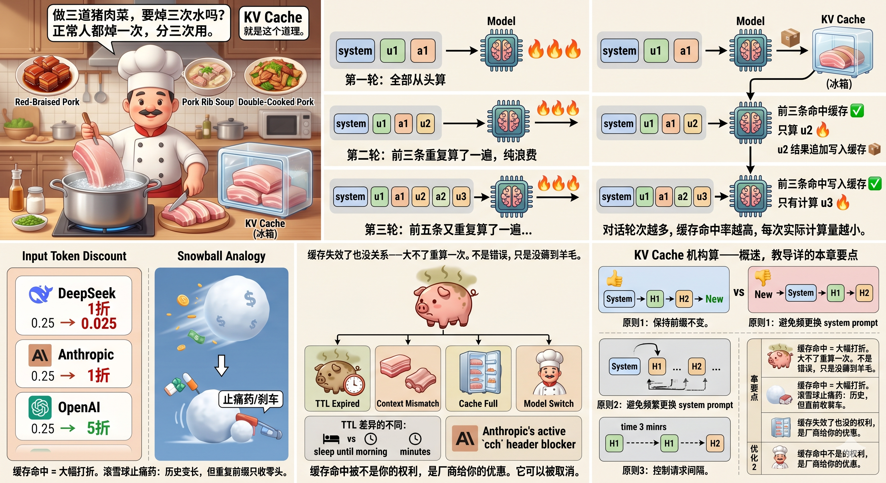

# 第 13 章:KV Cache——猪肉焯水 🥩

## 13.1 做三道猪肉菜,要焯三次水吗?

红烧肉、排骨汤、回锅肉。

不管做什么猪肉菜,第一步永远是:冷水下锅,焯水去腥。

焯一次,做三道菜——你是焯一次还是焯三次?

正常人都焯一次。焯完分成三份,放冰箱。做哪道菜,拿哪份出来。

**KV Cache 就是这个道理。**



---

## 13.2 模型是怎么处理对话历史的

还记得第 9 章讲的吗——API 不帮你记聊天,每次请求你都得把完整对话历史传过去。

但你每次传的历史,**前面大部分内容是一模一样的。**

```text
第一轮:
messages = [
  {system: "你是翻译助手"},
  {user: "珠穆朗玛峰有多高?"},
  {assistant: "8848米"}
]
→ 全部从头算

第二轮:
messages = [
  {system: "你是翻译助手"},        ← 跟第一轮一样
  {user: "珠穆朗玛峰有多高?"},     ← 跟第一轮一样
  {assistant: "8848米"},           ← 跟第一轮一样
  {user: "那第二高呢?"}           ← 只有这一条是新的
]
→ 前三条重复算了一遍,纯浪费

第三轮:
messages = [
  {system: "你是翻译助手"},
  {user: "珠穆朗玛峰有多高?"},
  {assistant: "8848米"},
  {user: "那第二高呢?"},
  {assistant: "乔戈里峰,8611米"},
  {user: "它在哪个国家?"}         ← 只有这一条是新的
]
→ 前五条又重复算了一遍……
```

如果每一轮都从头到尾算一遍,前面重复的部分就白白烧了算力和钱。

<iframe 
  src="/html_demos/KV Cache 机制交互式演示-第十三章.html" 
  width="100%" 
  height="800px"
  style="border: none; border-radius: 8px;">
</iframe>

---

## 13.3 焯一次水,后面所有菜复用

KV Cache 做的事:

> 第一次算完后,把中间结果存进缓存。后面的请求,前缀命中缓存的部分直接跳过,只算新增的。

```text
第一轮请求:[system, user₁, assistant₁]
  → 全部从头算 🔥🔥🔥
  → 算完后写入缓存 📦(猪肉焯水,进冰箱)

第二轮请求:[system, user₁, assistant₁, user₂]
  → 前三条命中缓存 ✅(直接从冰箱拿焯好的肉)
  → 只算 user₂ 🔥(只炒新加的料)
  → user₂ 的结果追加写入缓存 📦

第三轮请求:[system, user₁, assistant₁, user₂, assistant₂, user₃]
  → 前五条命中缓存 ✅
  → 只算 user₃ 🔥
```

> 对话轮次越多,缓存命中率越高,每次实际计算量越小。

---

## 13.4 缓存命中和你的账单

缓存命中 = 省钱。而且省得远超你的预期。

虽然每次请求你都要把完整历史传过去(input token 照常显示在请求里),但计费时缓存命中的部分会大幅打折。

缓存命中完全看厂家良心,一些模型的缓存需要付费写入，比如Claude

| 厂商 | 缓存命中折扣 | 举个数 |
| :--- | :--- | :--- |
| DeepSeek | **一折** | 原价 0.25 元/百万 token → 命中后 0.025 元 |
| Anthropic | **一折** | 缓存输入按基础价 10% 计费 |
| OpenAI | **五折** | 缓存输入 50% off （部分新模型（如GPT-5.5）缓存命中的折扣可能更高，可达 75%）|

第 4 章列过的 DeepSeek 缓存命中 0.025 元/百万 token——现在你知道这个数字背后的机制了。

第 10 章讲过滚雪球效应——每轮带完整历史,token 累计成本加速增长。KV Cache 是这个问题的止痛药:历史虽然越传越长,但重复的前缀部分命中缓存后只收零头。滚雪球还在滚,但速度被刹住了。

> 还记得第 9 章埋的钩子吗——
>
> "传归传,钱不一定全收。前面重复的部分可以通过 KV Cache 跳过计算。"
>
> 现在你知道为什么了。

---

## 13.5 缓存什么时候失效

冰箱里的焯水猪肉不是永久保鲜的。放久了会臭。

KV Cache 也一样,有几种情况会失效:

| 失效原因 | 触发条件 | 翻译成人话 |
| :--- | :--- | :--- |
| **TTL 到期** | 缓存超过保鲜期 | 猪肉放太久,臭了 |
| **上下文不匹配** | 新请求前缀跟缓存前缀不一致 | 之前焯的是五花肉,现在要的是排骨——不通用 |
| **缓存已满** | 服务端缓存容量有上限 | 冰箱塞满了 |
| **模型切换** | 换了一个模型 | 你换了个厨师,他不认上一位焯的肉 |

TTL 差多少?完全看厂家良心。

有的厂商缓存能撑到第二天——你睡了一觉醒来,昨天的对话前缀还在缓存里。有的只给你几分钟——Anthropic 的默认 TTL 大约 5 分钟,想要更长的缓存时间需要额外付费。

这是一个定价页面上不一定写得很显眼、但直接影响你账单的参数。选厂商的时候,别只看单价,也看缓存 TTL。

> 缓存失效了也没关系——大不了重算一次,多花点钱。不是错误,只是没薅到羊毛。

缓存命中也能被"故意搞坏"。

Anthropic 在新版 Claude Code 的请求里插入了一个叫 `cch` 的请求头——每次对话随机生成一串字符。这意味着如果你用第三方 API 转发服务来调用 Claude,每次请求的前缀都不一样(因为 `cch` 值变了),缓存永远命中不了。

这是厂商在技术层面防止第三方转发商"蹭"官方缓存。不过国内转发商很快找到了应对方案——技术对抗永远是道高一尺魔高一丈。

你不需要理解 `cch` 的实现细节。记住一件事就行:缓存命中不是你的权利,是厂商给你的优惠。它可以被取消。

---

## 13.6 怎么让自己的请求尽量命中缓存

三个原则:

**① 保持前缀不变。**

把 system prompt 和固定的历史对话放在前面,变化的放在后面。前缀越长越固定,命中率越高。

```text
👍 好:System → 历史对话1 → 历史对话2 → 新问题
👎 差:新问题 → System → 历史对话1 → 历史对话2
```

前缀变了,缓存全废。

**② 避免频繁更换 system prompt。**

System 是最前面的内容,一动它,后面全不匹配。每改一次 system,缓存从头开始建。

**③ 控制请求间隔。**

缓存有保鲜期。如果两次请求间隔太长,缓存可能已经过期。高频对话天然缓存命中率高;低频场景(比如每隔半小时才调一次)可能每次都是冷启动,薅不到缓存的羊毛。

---

## 本章要点

| 概念 | 一句话 |
| :--- | :--- |
| **KV Cache** | 猪肉焯水——前面算过的存起来,后面复用 |
| **缓存命中** | 对话轮次越多,命中越多,每次只算新增的 |
| **省多少** | DeepSeek 一折、Anthropic 一折、OpenAI 五折——远超你预期 |
| **滚雪球止痛药** | 历史越传越长,但重复前缀只收零头 |
| **失效条件** | TTL 到期、前缀不匹配、换模型、厂商主动破坏 |
| **优化原则** | 前缀不变、system 别乱改、控制请求间隔 |