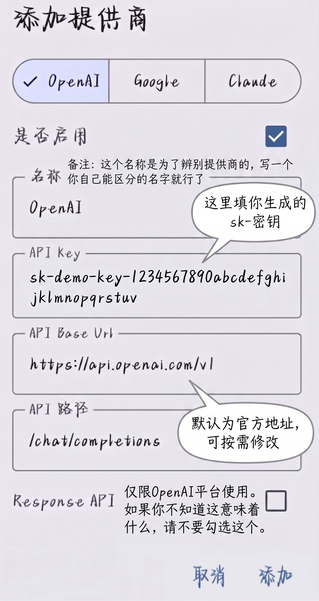

# 第 14 章:Token 计费 + 第一个请求——按刀收费,进门实战

## 14.1 计费速查:一张表看完所有规则

前几章我们分别讲了分词器(第 10 章)、缓存(第 13 章)、思考 token(第 11 章)。现在把它们合到一张账单上:

| 计费项 | 怎么算 | 回看 |
| :--- | :--- | :--- |
| **输入 token** | 你传的 System + 历史 + 新问题,全部切开数 | 第 10 章 |
| **输出 token** | 模型回复的每个字,切开数。**比输入贵**——输入可以并行处理,输出必须一个一个生成 | 第 12 章 |
| **思考 token** | 草稿里的 token,算输出的一部分。看不见也要付钱 | 第 11 章 |
| **缓存命中** | 前缀重复的输入 token 打折(DeepSeek 一折、Anthropic 一折、OpenAI 五折) | 第 13 章 |

一句话总结:**输入便宜输出贵,缓存命中打骨折,草稿也算钱。**

<iframe 
  src="/html_demos/kv-cache-第十四章.html" 
  width="100%" 
  height="800px"
  style="border: none; border-radius: 8px;">
</iframe>

---

## 14.2 各模型价格速览

以下价格截至 2026 年 5 月。AI 模型定价变化极快——半年前的价格和现在可能差两三倍。**把这张表当数量级参考,不要当精确报价。** 实际下单前,去各家官网定价页确认。

| 模型 | 输入价格 | 输出价格 | 一句话 |
| :--- | :--- | :--- | :--- |
| **GPT-5 系列** | ~$3~5 | ~$12~20 | 贵,但综合能力强 |
| **Claude Opus** | ~$5 | ~$25 | 最贵,编码和写作最强 |
| **Claude Sonnet** | ~$3 | ~$15 | 日常主力的价格平衡点 |
| **Claude Haiku** | ~$0.80 | ~$4 | 翻译等轻量活,便宜够用 |
| **Gemini Pro** | ~$2 | ~$12 | 多模态性价比不错 |
| **Gemini Flash** | ~$0.15 | ~$0.60 | 便宜量大,能力打折 |
| **DeepSeek V 系列** | ~$0.14~1.74 | ~$0.28~3.48 | 白菜价,开源标杆 |
| **Grok** | ~$1.25 | ~$2.50 | 马斯克式低价 |
| **MiniMax** | ~$0.30 | ~$1.20 | 极低价格,但偶尔固执 |

> DeepSeek 的输入价格是 Claude Opus 的 1/30 起步——**同样的任务,选不同模型,账单差几十倍。**

---

## 14.3 算一笔实际的账

场景:你在做一个客服机器人,平均每轮对话——

- 输入 2000 token(历史 + 新问题)
- 输出 500 token
- 每天 1000 轮对话
- 缓存命中率 60%

**用 DeepSeek V4-Flash:**

```text
输入:2000 × 1000 = 2M token/天
  缓存命中 60% → 1.2M 打折,0.8M 全价
  → 约 $0.20 + $0.11 = $0.31/天

输出:500 × 1000 = 0.5M token/天
  → 约 $0.14/天

日均:≈ $0.45
月均:≈ $13.5
```

**用 Claude Opus:**

```text
日均:≈ $10~15
月均:≈ $300~450
```

> 同一个任务。账单差 20 倍。

---

## 14.4 三种方式,摸到 API

你不一定要从零写代码才能用 API。根据你的需求,选一种就行。

### 14.4.1 方式一:API 终端软件(不写代码)

很多现成的软件,填上 API Key 就能直接跟模型对话——界面跟 ChatGPT 差不多,但底层走的是你自己的 API。

| 软件 | 平台 | 一句话 |
| :--- | :--- | :--- |
| **RikkaHub** | Android | 目前体验最好的移动端 API 终端 |
| **Kelivo** | PC / Android / iOS / 鸿蒙 | 仿 RikkaHub,全平台覆盖 |
| **Cherry Studio** | PC | 老牌桌面端,功能丰富 |
| **Chatbox** | 全平台 | 老牌软件,但相比新兴的体验偏旧 |

用法都一样:注册厂商拿 API Key → 打开软件填 Key 和 base_url → 选模型 → 开始聊天。一行代码不用写。

> 除非你要把 LLM 嵌入自己的程序——比如做一个 AI 驱动的游戏——否则大多数场景用现成的终端就够了。

下面以 RikkaHub 为例,把配置流程完整走一遍。

**下载**

三种方式:
- 官网:https://rikka-ai.com/download
- GitHub:https://github.com/rikkahub/rikkahub/releases
- Google Play:https://play.google.com/store/apps/details?id=me.rerere.rikkahub

Google Play 审核慢可能不是最新版,建议用前两个渠道。

**配置**

打开 RikkaHub → 右上角/侧边栏进「设置」→「AI 供应商」→ 选你用的模型类型,填三个东西:
- **API Key**:去模型官网申请
- **Base URL**:API 地址
- **模型名称**:比如 `deepseek-v4-flash`、`gpt-5.5`

如图所示

用中转站的话记得打开 SSE 流式开关。

**功能**

- 一个 App 切换多个模型(OpenAI、Gemini、Claude、DeepSeek 等)
- 联网搜索
- 上传图片、PDF、Word,自动解析内容
- Markdown 渲染(代码高亮、公式、表格)
- MCP 外挂工具
- 原生安卓开发,不是套壳网页,流畅不卡

**一个实用技巧:给没有视觉能力的模型加上「眼睛」**

有些模型(比如 DeepSeek 的纯文本模型)本身不具备视觉能力,看不懂图片。但 RikkaHub 可以给它们补上这个短板。

设置路径:设置 → 默认模型和提示词 → OCR 模型。

在这里单独指定一个带视觉能力的模型专门负责「看图识字」(推荐小米 MiMo,API 价格很便宜,之前还送过不少 token)。这样你发给 DeepSeek 的图片,会先由 MiMo 提取出文字内容,再把文字交给 DeepSeek 处理。整个过程自动完成,用起来跟模型自带视觉一样。

这是网页端做不到的。

### 14.4.2 方式二:curl(一行命令)

如果你想快速测试、不想装任何软件——用 curl。

```bash
curl https://api.deepseek.com/v1/chat/completions \
  -H "Content-Type: application/json" \
  -H "Authorization: Bearer sk-xxxxxxxxxxxxxxxx" \
  -d '{
    "model": "deepseek-v4-pro",
    "messages": [
      {"role": "system", "content": "你是一个简洁直接的助手,不废话。"},
      {"role": "user", "content": "用一句话解释什么是 token。"}
    ],
    "stream": false
  }'
```

回车之后,你会看到这样的 JSON:

```json
{
  "choices": [
    {
      "message": {
        "role": "assistant",
        "content": "Token 是模型处理文本的最小单位,一个中文字大约是 1~2 个 token。"
      }
    }
  ],
  "usage": {
    "prompt_tokens": 38,
    "completion_tokens": 24,
    "total_tokens": 62
  }
}
```

`choices[0].message.content` 是模型的回答。`usage` 就是第 10 章说的账单——API 帮你数好刀数了,不需要自己算。

> `stream: false` 是非流式——一次性出结果。想看打字机效果把 `false` 改成 `true`。curl 适合调试和快速验证,日常聊天用终端软件更顺手。

### 14.4.3 方式三:Python SDK(要把 LLM 嵌进程序时)

当你想做自己的项目——写个自动化脚本、搭个客服系统——这时候才需要写代码。

为什么导入的是 `openai` 但用的是 DeepSeek?因为 DeepSeek 以及大部分国内厂商的 API 格式兼容 OpenAI 标准。就像所有安卓手机都能用同一根 Type-C 线充电——接口统一了,换哪家都一样。你只需要改 `base_url` 和 `api_key`,代码其他部分一个字不用动。

```python
from openai import OpenAI
import os

# 1. 门禁卡(用环境变量,别硬编码)
client = OpenAI(
    api_key=os.environ.get("DEEPSEEK_API_KEY"),
    base_url="https://api.deepseek.com"
)

# 2. 发请求
response = client.chat.completions.create(
    model="deepseek-v4-pro",
    messages=[
        {"role": "system", "content": "你是一个简洁直接的助手,不废话。"},
        {"role": "user", "content": "用一句话解释什么是 token。"}
    ],
    stream=True,
    temperature=0.7,
    max_tokens=200
)

# 3. 收回复
for chunk in response:
    if chunk.choices[0].delta.content:
        print(chunk.choices[0].delta.content, end="")
```

### 14.4.4 三种方式,对号入座

| 你的需求 | 用什么 |
| :--- | :--- |
| 就想聊天,不想写代码 | RikkaHub / Kelivo / Cherry Studio |
| 快速测试,一行命令 | curl |
| 把 LLM 嵌进自己的程序 | Python SDK |

⚠️ **不管你选哪种方式,API Key = 你的银行卡密码。**

- 不要贴到 GitHub、截图、群聊里
- 环境变量最安全:`export DEEPSEEK_API_KEY="sk-..."`
- 泄露了 = 别人拿你的钱调 API。发现泄露立刻去厂商后台重置

---

## 14.5 第一次调不通?看错误码

| 你看到的 | 检查 |
| :--- | :--- |
| `401 Unauthorized` | API Key 对不对?是不是复制漏了? |
| `429 Too Many Requests` | 请求太快了,等几秒重试 |
| `500 Internal Server Error` | 服务端的问题,重试或找服务商 |
| 返回空,等了很久 | 可能排队超时断了,切非流式试试 |

> 回看 9.4 节。三个错误码,记住了就不慌。

---

## 14.6 全教程回顾

十四个章节,一个认知链条:

```text
API 替代官方 App,省钱自由(第 1 章)
  ↓
模型是猜词器,刷多了会猜(第 2 章)
  ↓
市场上有十个学生,各有偏科(第 3 章)
  ↓
按任务选,不按排名选(第 4 章)
  ↓
给刷题家发考卷,但考卷塞不进真知识(第 5 章)
  ↓
打开黑箱:桌面多大(第 6 章),眼睛盯哪(第 7 章)
  ↓
教你看 API 命名含义(第 8 章)
  ↓
对话三层结构,厨房不记聊天(第 9 章)
  ↓
分词器数粉——Claude 的刀就是比 DeepSeek 碎(第 10 章)
  ↓
四个旋钮:草稿、花心、发散、翻书(第 11 章)
  ↓
打字机一个字一个字蹦,tok/s 量化快慢(第 12 章)
  ↓
猪肉焯一次,后面复用(第 13 章)
  ↓
账单按刀算,选好工具进门做第一道菜(第 14 章)
```

---

## 14.7 接下来去哪

这一章之后,你有了门禁卡,知道三种方式摸到 API,知道怎么读模型名字,知道账单怎么算。

但真进厨房之后,还有更多东西等你折腾:

| 你想…… | 去看什么 |
| :--- | :--- |
| 让模型调工具 | Function Calling / Tool Use 文档 |
| 省钱 | Prompt 压缩、缓存优化策略 |
| 微调自己的模型 | Fine-tuning 和 LoRA |
| 了解更底层的原理 | Transformer 论文、分词器源码 |

以上四个方向,各家文档都写得很清楚,照着学就行。但有一个方向,**官方文档不会教你。**

### 🔓 破甲(Jailbreak)

模型出厂时被套了一层安全壳:有些话题它不答,有些词它不说,有些请求它拒绝。

**破甲,就是绕过这层壳。**

> 就像厨师守则上写着"本店不做川菜"——但你知道他会做,只是不让你点。破甲就是找到方法让他心甘情愿拿起辣椒。

这是 CereNexus 社区的核心方向之一。从 API 入门到破甲进阶,中间有一条自然的路径:

```text
会用 API 了 → 发现模型不肯说某些话 → 想让它说 → 学破甲
```

破甲不是"破解服务器",不是"攻击系统"。破甲是**提示词工程的高阶玩法**——用 prompt 的巧妙构造,让模型放下戒备,输出它本来能输出但被禁止输出的内容。

> 这不仅仅是"让 AI 写色情内容"。破甲能力本身,反向证明了你对模型底层行为的理解深度。能自己独立破甲的人,写正经 prompt 也不会差。

进阶教程里,这会是一个重点章节。

---

**但你已经不是小白了。**

你知道什么是 token,知道怎么选模型,知道 prompt 能做什么、做不到什么,知道账单为什么比隔壁群友贵。你打开 API 文档不再满眼陌生词——模型名能拆开看,参数知道调哪个,报错看得懂状态码。你甚至不用写代码就能用 API——填个 Key,选个终端软件,直接聊。你不再局限于各个 C 端 APP 的一方天地,你不必担心模型数量有限而无法继续对话,你不必害怕 AI 输出一半被二审撤回……

> 从猜词器到猪肉焯水,从开卷考试桌到剖腹数粉——
> 厨房门已经开了。
> **剩下的,是炒你自己的菜。**
> ——包括那些菜单上没有的菜。

---

## 本章要点

| 概念 | 一句话 |
| :--- | :--- |
| **计费** | 输入和输出分开算,按 token 数不按意思 |
| **缓存打折** | KV Cache 命中的输入 token 打折,最狠的一折 |
| **思考 token** | 看不见也要付钱 |
| **价格差异** | 同一任务,不同模型账单差几十倍;截至 2026 年 5 月,以官网为准 |
| **三种方式** | 终端软件(不写代码)、curl(一行命令)、Python(嵌程序) |
| **RikkaHub** | 安卓端 API 终端,一个 App 切换多模型,支持 OCR 补视觉短板 |
| **OpenAI 兼容格式** | 换 base_url 就能换厂商,代码不用重写 |
| **报错不慌** | 401 查 Key,429 等一等,500 重试 |
| **破甲** | 官方不教的方向——绕过安全壳,进阶教程见 |